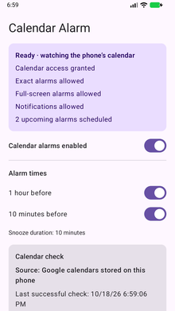
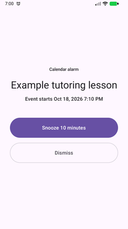

# Calendar Alarm

**Calendar events that ring like an alarm.**

A small Android app that turns Google Calendar events already synced to the phone into audible, full-screen reminders, with Snooze and Dismiss.

| Choose the reminder times | When an alarm goes off |
| :---: | :---: |
|  |  |

*Real app screenshots from an Android emulator, using a fictional lesson. Tap either image for the full-size view.*

---

## Why I made it

I built this after missing a tutoring lesson. A quiet calendar notification was too easy for me to miss while asleep or busy. I wanted the reminder to behave like a phone alarm: ring, wake the screen, and keep asking for attention until I dealt with it.

The idea was to keep using my existing calendar and add the kind of alert I needed. I now use version 1.1 regularly on my Google Pixel 9a, and it has been working well for me.

## What it does

- Schedules reminders **one hour and ten minutes before** eligible timed events. Each reminder time has its own switch.
- Shows upcoming alarms and the result of the latest calendar check.
- Opens an alarm screen with looping alarm sound, vibration, **Snooze 10 minutes** and **Dismiss**.
- Updates the schedule when synced events move or disappear, including recurring events.

There is one overall switch for calendar alarms. At the moment, the enabled reminder times apply to **all eligible events**; choosing individual events is a possible next addition.

## The basic approach

Google's calendar sync puts events on the phone. Calendar Alarm reads that local calendar, works out the reminder times, and asks Android to schedule the alarms. It checks the schedule again as calendar data changes, with a periodic background check as a fallback.

The app reads visible Google calendars with sync enabled and looks ahead 30 days. It skips all-day, declined and cancelled events, and reminder times that have already passed. It reads calendar events without editing them, and requests no Internet access. There is no separate app account, advertising or analytics.

## From the first attempt to daily use

**Around September 2026 — the first version.** I used AI assistance to turn the idea into a native Kotlin/Compose app. The first attempt had bugs: switches did not work properly, and rescanning gave too little feedback to tell what had happened.

**Version 1.1 — fixing the practical problems.** The switches were repaired, settings changes were queued so a busy scan would not lose them, and the screen gained clearer scan results and error feedback. A failed calendar read also stopped being treated as an empty calendar.

**Now — a tool I keep using.** Version 1.1 has been working well in regular use on my Pixel 9a. I supplied the requirements, tried the app and used my feedback to guide the changes. Codex helped write the code, tests and documentation.

## Trying it

You need an Android phone with Google Calendar events already syncing to it. The project is configured for Android 8.0 or later; my regular-use experience is on a Pixel 9a.

Build and install the app with Android Studio, then grant the access shown in its permission checklist: calendar, notifications, exact alarms and full-screen alarms, as applicable to your Android version. Enable the reminder times you want and check the upcoming-alarm list.

For a quick trial, create a fictional event about 12 minutes ahead, let it sync, and tap **Rescan calendar now**. Its ten-minute reminder should be due about two minutes later. Lock the phone and try the alert, Snooze and Dismiss.

[Build, installation and troubleshooting](docs/SETUP.md)

## Current limits and what I might try next

The reminder times and snooze duration are fixed. There is no individual-event selection yet. **Rescan reads the phone's calendar**; an edit made elsewhere must sync to the phone first. Alarm volume, Do Not Disturb, permissions and device battery settings can affect the experience, and I have not tested it across a range of phones.

The next idea is to let me choose which events should use an alarm, so ordinary calendar entries can stay quiet.

## Credits and license

An AI-assisted hobby project by Vytenis Narmontas. Built with Kotlin, Jetpack Compose and Android's calendar and alarm tools.

My code and documentation use the [MIT license](LICENSE). Third-party components retain their own licenses; see [third-party notices](THIRD_PARTY_NOTICES.md). The screenshots show this app with fictional sample data; Android system UI belongs to its respective owners.
