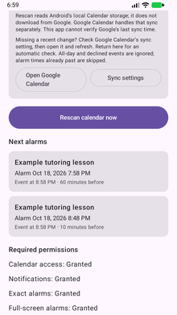

# Build and try Calendar Alarm

## Requirements

- Android Studio with a compatible JDK (the Studio bundled JBR works).
- Android SDK platform 37.0, as requested by the project configuration.
- An Android device running Android 8.0 or later, or an isolated emulator.
- For normal use, Google calendars already synchronized to the device.

The project pins Gradle 9.6.0 and Android Gradle Plugin 9.4.0. Android Studio can show which SDK packages are missing. Allow it to create your local SDK configuration; `local.properties` is machine-specific and is excluded from Git.

## Build and install

Open the repository folder in Android Studio, let Gradle sync, select the `app` configuration and run it on your device. No Google API key or OAuth client is needed.

On Windows, you can also build from the repository folder in PowerShell, with `JAVA_HOME` set to your JDK and the Android SDK configured:

```powershell
.\gradlew.bat testDebugUnitTest lintDebug assembleDebug --console=plain
```

The debug app is written to `app/build/outputs/apk/debug/app-debug.apk`.

With Android SDK Platform Tools on your PATH and USB debugging enabled on your own phone:

```powershell
adb -d install -r .\app\build\outputs\apk\debug\app-debug.apk
```

An update must be signed with the same key as the installed version. Your locally generated debug key may differ from the one used for an earlier installation. A debug build is intended for trying the project; no prebuilt APK is included in this repository.

## First run

1. Confirm that the events you want appear in Google Calendar on this phone and that their calendars have synchronization enabled.
2. Open Calendar Alarm. Complete the permission checklist for calendar access, notifications, exact alarms and full-screen alarms, where required.
3. Enable calendar alarms and the one-hour and/or ten-minute reminder switches.
4. Tap **Rescan calendar now**. Check the calendar scan summary and upcoming alarms.
5. Try a fictional timed event about 12 minutes ahead. After it syncs, the ten-minute reminder should be roughly two minutes away. The one-hour reminder is skipped because its time has passed.
6. Lock the phone, wait for the alert and try Snooze and Dismiss. Check that your alarm volume is audible.

### Example schedule

[](../media/upcoming-alarms.png)

*Actual app screenshot from an Android emulator, using fictional sample data.*

## If an event or alarm is missing

- **The edit was made elsewhere:** wait for Google Calendar to sync it to the phone. Calendar Alarm's Rescan button only reads Android's local calendar storage. The app includes shortcuts to Google Calendar and sync settings.
- **The event is excluded:** all-day, declined or cancelled events, hidden calendars, non-Google calendars and past reminder times are skipped. The lookahead is 30 days.
- **A permission changed:** return to the app and check its permission checklist and scan status.
- **No full-screen display:** check full-screen alarm access and the Calendar alarms notification channel. Android can fall back to a notification when full-screen access is unavailable.
- **No audible alert:** check alarm-stream volume and Do Not Disturb settings, including whether alarms are allowed.
- **Changes take time in the background:** Android controls background work. After an important edit has synced, open the app and rescan to check the local schedule. Do not force-stop the app; reopen it if you have done so.

## Development checks

The source includes 15 unit tests for reminder planning and reconciliation, and six emulator regression tests for controls, persistence, calendar changes, error handling and locked-screen alarm interaction.

The publication copy was built on October 18, 2026: unit tests passed, lint reported no issues, and all six regression tests passed on an Android API 37 emulator. The alarm interaction test checks the ten-minute snooze deadline, then shortens only its test record to exercise the second firing without waiting ten minutes. The emulator ran with audio disabled, so this run did not assess audible output. Regular use on my Pixel 9a is separate from these emulator checks.

To build the test harness:

```powershell
.\gradlew.bat assembleDebugAndroidTest --console=plain
```

Run instrumentation tests only on an isolated emulator. They create and remove synthetic calendar entries and reset this app's alarm settings and records; the test APK is not the normal app.

## Finding your way around the source

- `MainActivity.kt`: controls, permission checklist, scan feedback and upcoming alarms.
- `calendar/`: read-only calendar queries and schedule reconciliation.
- `core/`: reminder rules and event/alarm comparisons.
- `alarm/`: Android alarm scheduling, alert screen, sound, Snooze and Dismiss.
- `background/`: background checks and restoration triggers.
- `data/`: local settings and alarm records.

These folders are under `app/src/main/java/com/calendaralarm/`.
